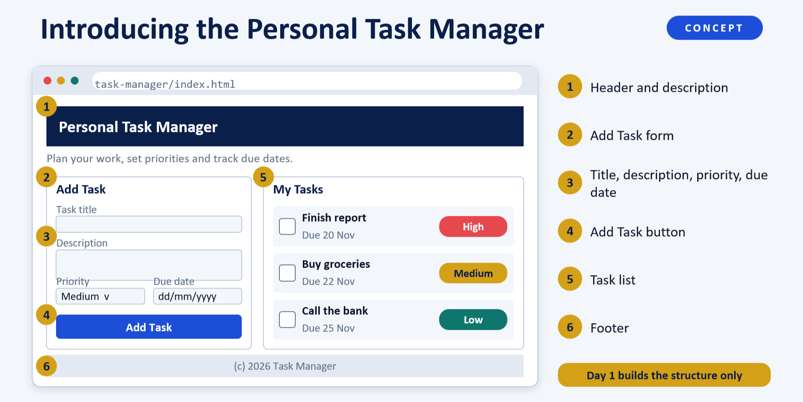

# Task Manager

A beginner-friendly personal task manager built as the practical project of a five-day **Introduction to Web Development**. The application is developed step by step, starting with a semantic HTML foundation on Day 1 and growing into a styled, interactive, and finally TypeScript-typed application by Day 5.

> **Current status:** Day 3 — JavaScript and DOM manipulation. The application is fully interactive: tasks are dynamically rendered from application state, new tasks can be added with client-side validation, completion status can be toggled via checkboxes, tasks can be deleted, and empty-state messaging responds dynamically. Data persistence using Web Storage will be implemented on Day 4. See [Progressive Development Roadmap](#progressive-development-roadmap).

---

## Table of Contents

- [Project Overview](#project-overview)
- [Project Concept](#project-concept)
- [Learning Objectives](#learning-objectives)
- [Technologies Used](#technologies-used)
- [Features](#features)
- [Project Structure](#project-structure)
- [Getting Started](#getting-started)
- [How to Run the Project](#how-to-run-the-project)
- [How to Use the Application](#how-to-use-the-application)
- [Progressive Development Roadmap](#progressive-development-roadmap)
- [Learning Outcomes](#learning-outcomes)
- [Future Improvements](#future-improvements)
- [Contributing](#contributing)
- [License](#license)

---

## Project Overview

**Task Manager** is a small web application for planning work. Users can capture a task by entering a title, an optional description, a priority level, and a due date, then review their tasks in a single list.

The project exists to make web development concepts concrete. Instead of isolated exercises, each day adds a layer to the same application:

- **Day 1** establishes the page structure with semantic HTML.
- **Day 2** turns that structure into a designed, responsive interface with CSS.
- **Day 3** makes the interface interactive with JavaScript and the DOM.
- **Day 4** adds data handling with arrays, objects, JSON, storage, and object-oriented patterns.
- **Day 5** introduces TypeScript and applies typing to the existing code.

The goal is not only a working task manager, but a visible record of how a real frontend project is assembled one concern at a time.

## Project Concept

The concept below was presented on **Day 1** of the training and defines the visual and functional direction of the project.



The concept illustrates the intended end state: a header and description, an **Add Task** form with title, description, priority, and due date, an **Add Task** button, a task list with priority badges, and a footer.

> **Note:** The screenshot represents the project vision, not the current implementation. At the Day 1 stage, the repository contains only the HTML structure. Styling, task cards, badges, and interactive behaviour are introduced on later days.

## Learning Objectives

By building this project, learners practise:

- Structuring a page with semantic HTML5 elements such as `header`, `main`, `section`, `form`, and `footer`.
- Building accessible forms with labels, input types, and built-in validation.
- Styling an interface with CSS, including layout, spacing, colour, and typography.
- Creating responsive layouts with Flexbox and CSS custom properties.
- Selecting and manipulating DOM elements with JavaScript.
- Handling user events such as form submission and button clicks.
- Modelling data with arrays and objects, and serialising it with JSON.
- Persisting data in the browser with Web Storage.
- Organising code with object-oriented programming principles.
- Applying TypeScript types to functions, data models, and DOM interactions.
- Reading, extending, and documenting an existing codebase.

## Technologies Used

Only the technologies below are present in the repository today.

| Technology | Role in the project | Status |
| --- | --- | --- |
| HTML5 | Page structure, semantic sections, and the task form | Implemented |
| CSS3 | Visual design, design tokens, Flexbox/Grid layout, badges, responsive design | Implemented (`styles.css`) |
| JavaScript (ES6+) | Dynamic DOM manipulation, form validation, event handling, state management | Implemented (`app.js`) |
| JSON / Web Storage | Saving tasks between page reloads | Planned |
| TypeScript | Typed version of the application logic | Planned |

**No build tools, package managers, frameworks, or third-party dependencies are used at this stage.** The project runs directly in a web browser.

The document links to `styles.css` for styling and loads `app.js` with the `defer` attribute for interactivity.

## Features

### Implemented today (Day 1, Day 2 & Day 3)

- **Structure & Forms (Day 1):**
  - Semantic HTML5 layout with `header`, `main`, `section`, and `footer`.
  - Accessible form with linked labels, placeholder hints, and required attributes.
  - Priority selector dropdown (Low, Medium, High).
  - Date picker for due dates.
  - Empty-state placeholder element.
- **Design & Layout (Day 2):**
  - Design system with CSS custom properties (`:root`) for colors, fonts, spacing, radii, and shadows.
  - Two-column card layout on desktop matching `images/concept.png`.
  - Sticky footer and responsive grid adapting cleanly to mobile screens (`@media (max-width: 768px)` and `480px`).
  - Card-based UI for form and task list with subtle borders and elevation.
  - Focus indicators (`:focus-visible` and custom focus rings) for keyboard accessibility.
  - Interactive hover and active feedback on buttons and task cards.
  - Priority pill badges (Red for High, Amber for Medium with dark text, Teal for Low).
  - Completed task styling with subtle muted tones and strikethrough.
  - Respects user preferences via `@media (prefers-reduced-motion: reduce)`.
- **Interactivity & State (Day 3):**
  - **Data drives the DOM:** Application state stored in a `tasks` array; `renderTasks()` projects data cleanly onto `#task-list`.
  - **Dynamic Task Creation:** `submit` event handler validates inputs, builds a new task object, prepends or appends to the state, and clears the form.
  - **Input Validation:** Whitespace trimming and title validation with an inline, accessible error message (`#form-error` with `role="alert"`).
  - **Toggle Completion:** Checkbox event listener flips task status, applies `.completed` styling, and updates accessibility `aria-label` text.
  - **Task Deletion:** Delete button removes the task by its unique numeric ID and immediately re-renders the list.
  - **Empty-State Messaging:** Toggles the `#empty-message` element when zero tasks remain.
  - **Safe Rendering / XSS Prevention:** All user-supplied text is inserted safely via `textContent` rather than `innerHTML`.

### Not implemented yet

These behaviours are part of the project plan but are **not** present in the code:

- Saving tasks in the browser with Web Storage / LocalStorage (Day 4 Advanced JavaScript).
- Object-oriented patterns and task class modeling (Day 4 Advanced JavaScript).
- TypeScript typing and compilation (Day 5 TypeScript).

## Project Structure

```text
task-manager/
├── index.html          # Page structure: header, add-task form, task list, empty state, footer
├── styles.css          # Design tokens, reset, two-column layout, cards, badges, responsive rules
├── app.js              # Application state, validation, DOM rendering, and event handlers
├── README.md           # Project documentation (this file)
└── images/
    └── concept.png     # Original Day 1 concept presented
```

| Path | Description |
| --- | --- |
| `index.html` | The single HTML page. Contains the semantic layout, form, and script/style links. |
| `styles.css` | Complete stylesheet containing design tokens, two-column layout, cards, and responsive media queries. |
| `app.js` | Interactive application logic: state array, validation, element creation, completion, deletion, and DOM updates. |
| `images/concept.png` | The original concept image from Day 1. It is the design reference for later stages. |
| `README.md` | Documentation covering the project, its structure, and its learning roadmap. |

Additional files such as a stylesheet, JavaScript modules, and TypeScript configuration will be added as the training progresses. They are listed in the roadmap, not in the current structure.

## Getting Started

### Prerequisites

- A modern web browser (Chrome, Firefox, Safari, or Edge).
- A code editor such as Visual Studio Code — recommended for the Live Preview option, but not required.
- [Git](https://git-scm.com/) — only needed if you want to clone the repository.

The project is entirely frontend. No server, runtime, package manager, or dependency installation is required to view it.

### Step 1 — Get the project

Clone the repository:

```bash
git clone https://github.com/trgeorgeogilo/task-manager.git
cd task-manager
```

Alternatively, download the repository as a ZIP from GitHub and extract it.

### Step 2 — Confirm the files

Your project folder should contain:

```text
index.html
README.md
images/concept.png
```

### Step 3 — Open the project

Open `index.html` directly in a browser, or preview it inside VS Code. Both options are described in the next section.

## How to Run the Project

The application is plain HTML, so there is no build step and nothing to install. Choose either option below.

### Option A — Open the file in your browser

Double-click `index.html` in your file manager, or drag it into a browser window. The page opens with a `file://` URL and works immediately.

### Option B — Preview it in VS Code

1. Open the project folder in Visual Studio Code.
2. Install the **Live Preview** extension (`ms-vscode.live-server`) from the Extensions panel.
3. Right-click `index.html` in the Explorer and choose **Show Preview**, or run **Live Preview: Show Preview (Internal)** from the Command Palette (`Ctrl+Shift+P`).
4. The page opens in an embedded browser inside VS Code and refreshes when you save changes.

This option is convenient while developing, because you can edit the HTML and see the result without leaving the editor.

> **Note:** Visual Studio Code's **Live Server** extension (`ritwickdey.liveserver`) is an equally valid alternative. Either preview tool can be used — neither is a project dependency.

## How to Use the Application

The current version is a structural prototype. You can explore the interface, but tasks are not yet saved.

1. Open the application using either option in [How to Run the Project](#how-to-run-the-project).
2. In the **Add Task** section, enter a **Title**. This field is required.
3. Optionally add a **Description**.
4. Choose a **Priority** — Low, Medium, or High. Medium is selected by default.
5. Optionally choose a **Due date**.
6. Click **Add Task**.

Because no JavaScript is connected to the form yet, submitting it does not create a task. The browser may reload the page, and the **My Tasks** list remains empty. This is expected at the Day 1 stage and is the first behaviour addressed during the JavaScript sessions.

## Progressive Development Roadmap

The project is built incrementally. The table separates what is complete from what is planned.

| Day | Topic | Focus | Project work | Status |
| --- | --- | --- | --- | --- |
| **Day 1** | HTML5 | Semantic structure and forms | Page header, add-task form, task list container, footer | **Completed** |
| **Day 2** | CSS | Layout, colour, typography, responsiveness | Stylesheet, Flexbox layout, CSS variables, priority colours, hover and focus states, responsive behaviour | **Completed** |
| **Day 3** | JavaScript | Programming fundamentals and the DOM | Reading form values, preventing default submission, creating task elements, event handling, basic task interactions | **Completed** |
| **Day 4** | Advanced JavaScript | Data modelling and persistence | Arrays and objects for tasks, JSON serialisation, Web Storage, object-oriented structure, completion and deletion | Planned |
| **Day 5** | TypeScript | Static typing | TypeScript setup, typed task models, typed functions, DOM type annotations, migration of the JavaScript logic | Planned |

### What each day adds

**Day 1 — HTML5 (complete)**
The page is divided into meaningful regions using `header`, `main`, `section`, and `footer`. The form uses `label` elements linked to inputs by `for` and `id`, an appropriate `input type="date"`, a `select`/radio controls for priority, and a `required` attribute for the title. This provides structure, accessibility, and built-in validation without any styling or scripting.

**Day 2 — CSS (complete)**
A stylesheet (`styles.css`) is connected to `index.html`. It establishes a design token system using CSS custom properties (`:root`), two-column card layout, responsive containers, priority badges matching the concept design, interactive hover and active states, accessible focus indicators, and mobile adaptations.

**Day 3 — JavaScript (complete)**
Interactive logic is implemented in `app.js`. Application state is tracked in a structured `tasks` array. A `renderTasks()` function builds cards dynamically with DOM methods, user input is validated on submit with inline error alerts, checkboxes toggle completion state, task cards can be deleted, and the empty-state message automatically reflects list emptiness.

**Day 4 — Advanced JavaScript (planned)**
Tasks will become structured objects stored in an array. Learners will serialise that data with JSON, save and restore it using the browser's storage APIs, and reorganise the code using object-oriented principles so that task behaviour lives with the task data. Completion and deletion will be added here.

**Day 5 — TypeScript (planned)**
The application logic will be migrated to TypeScript. Learners will define interfaces for task data, add parameter and return types, handle nullable DOM lookups, and use the compiler to catch mistakes before runtime.

> Roadmap items are learning milestones. Day 1, Day 2, and Day 3 are reflected in the current code.

## Learning Outcomes

After completing the full project, learners should be able to:

- Read and write clean, semantic HTML that is accessible by default.
- Turn a design reference into a responsive CSS layout.
- Explain how the DOM represents a page and how to update it safely.
- Handle form submissions and user events without relying on a framework.
- Choose appropriate data structures for application state.
- Persist and restore data using JSON and Web Storage.
- Organise small applications into cohesive, reusable objects or modules.
- Add TypeScript types to existing JavaScript and resolve compiler feedback.
- Work with Git and GitHub to track progress across the week.
- Document a project so that another person can run and understand it.

## Future Improvements

The following ideas are **not implemented**. They are reasonable next steps after the training:

- Complete the Day 2–5 roadmap described above.
- Add editing of existing tasks.
- Add filtering by status or priority, and sorting by due date.
- Add a search field for larger task lists.
- Show clear empty, loading, and error states in the task list.
- Add overdue and due-today indicators based on the due date.
- Support keyboard-only task management with visible focus styles.
- Review and validate the HTML structure, then add the missing viewport metadata for mobile rendering.
- Add automated checks for HTML validity and TypeScript type safety.
- Deploy the finished application to a static hosting service.

## Contributing

This repository is a learning project, and contributions that support that goal are welcome.

1. Fork the repository.
2. Create a branch with a descriptive name:

   ```bash
   git checkout -b feature/add-task-filter
   ```

3. Make a focused change and test it in the browser.
4. Commit with a clear message:

   ```bash
   git commit -m "Add filter for completed tasks"
   ```

5. Push the branch and open a pull request describing what changed and why.

### Suggested practice exercises

- Recreate the header and form from the concept image using only semantic HTML.
- On Day 2, style one section at a time and compare it with `images/concept.png`.
- On Day 3, add a task to the list before looking at the reference solution.
- On Day 4, save tasks, reload the page, and confirm they return.
- On Day 5, add types to a single function first, then expand outward.

Please keep changes small and readable — clarity matters more than cleverness in a learning codebase.

## License

No license file is currently included in this repository. Licensing terms have not yet been specified. If you intend to reuse or distribute this project, contact the repository owner first.

---

**Training:** Introduction to Web Development — five days
**Project stage:** Day 3 — JavaScript and DOM manipulation
**Repository:** [github.com/trgeorgeogilo/task-manager](https://github.com/trgeorgeogilo/task-manager)
